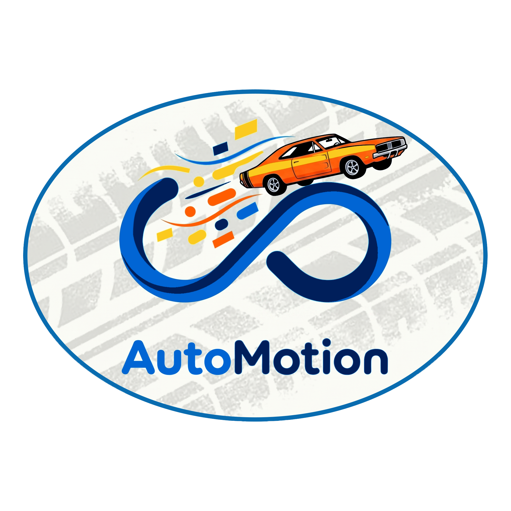

<div align="center">



# AutoMotion

**Masaüstünde yaşayan minyatür araçlar — Windows için şeffaf, fizik tabanlı bir "desktop pet" simülatörü.**

[](https://github.com/yagizturkmen-ceng/automotion/actions/workflows/ci.yml)


</div>

---

## Hakkında

AutoMotion, ekranınızda serbestçe dolaşan, yerçekimine tabi, sürüklenip fırlatılabilen araçlar (araba, kamyon, otobüs, motosiklet, traktör, helikopter…) ekleyen bir masaüstü uygulamasıdır. *VPet-Simulator*, *Desktop Goose* ve *Shimeji* gibi masaüstü arkadaşı uygulamalarından esinlenmiştir; evcil hayvan yerine araç simüle eder.

Araçlar kendi başına gezinir, yakıt tüketir, hasar alır, kargo teslim edip para kazanır; ekran kenarlarına ve odaktaki pencerenin üstüne "tırmanabilir".

## Özellikler

| Alan | Neler var |
|---|---|
| **Fizik** | Yerçekimi ve sönümlü sekme, sürükle-fırlat, kenar tırmanma, aktif pencere üzerinde sürüş, uçuş modu |
| **Yapay zekâ** | Gezinme / kovalama / kaçma durumları, Q-Learning ajanı, sağ tıkla rota çizme, çoklu seçim ve grup komutu |
| **Oyun döngüsü** | Yakıt, hasar ve onarım; kargo teslimat görevleri; trafik ışıkları; yağmur ve gece-gündüz döngüsü |
| **Ekonomi** | Para sistemi, kalıcı yükseltmeler (hız, hızlanma, verimlilik, dayanıklılık), dekorasyonlar, dorse/ekipman |
| **Eklentiler** | `Expansion` tabanlı mod mimarisi — Trafik, Ekonomi ve Görev eklentileri hazır gelir |
| **Kişiselleştirme** | 8 tema (cam, gün batımı, otomatik gece/gündüz…), kendi araç görselini içe aktarma (otomatik arka plan temizleme), ölçekleme |
| **Kalıcılık** | JSON kayıt sistemi, 60 sn'de bir otomatik kayıt, kayıt yönetim ekranı |
| **Entegrasyon** | Sistem tepsisi, mini HUD widget'ı, MQTT ile IoT filo telemetrisi (Home Assistant / Mosquitto), Steamworks |
| **Yerelleştirme** | Türkçe ve İngilizce arayüz |

## Teknolojiler

- **C# / .NET 9** (`net9.0-windows`) ve **WPF**
- Win32 P/Invoke (aktif pencere takibi), `System.Text.Json`
- [MQTTnet](https://github.com/dotnet/MQTTnet), [NAudio](https://github.com/naudio/NAudio), [Steamworks.NET](https://github.com/rlabrecque/Steamworks.NET)
- **xUnit** ile 250+ birim testi

## Kurulum

Gereksinimler: Windows 10/11, [.NET 9 SDK](https://dotnet.microsoft.com/download/dotnet/9.0)

```bash
git clone https://github.com/yagizturkmen-ceng/automotion.git
cd automotion
dotnet run --project src/AutoMotion
```

Testleri çalıştırmak için:

```bash
dotnet test
```

Tek klasörlük dağıtım paketi:

```bash
dotnet publish src/AutoMotion -c Release -r win-x64 --self-contained
```

## Kısayollar ve kullanım

- **Sürükle-bırak**: aracı tutup fırlatın
- **Sağ tık**: rota çizin
- **Shift + tık / alan seçimi**: birden fazla aracı seçip birlikte yönlendirin
- **Delete**: seçili aracı silin
- Sistem tepsisindeki simgeden paneli açıp kapatabilir, hızlıca araç ekleyebilirsiniz.

## Proje yapısı

```
src/AutoMotion/
├── Models/        # Araç, eşya, oyun verisi modelleri
├── Services/      # Kayıt, ayarlar, tema, ses, yerelleştirme, IoT, Steam
├── Expansions/    # Eklenti (mod) sistemi
├── Views/         # Pencereler ve diyaloglar
├── Utilities/     # Yardımcı sınıflar
└── Assets/        # Araç görselleri, fontlar, dil dosyaları
tests/AutoMotion.Tests/   # xUnit testleri
docs/                     # Gereksinimler ve teknik raporlar
```

Ayrıntılı mimari açıklaması için [docs/AutoMotion_Proje_Raporu.md](docs/AutoMotion_Proje_Raporu.md) dosyasına bakın.

## Lisans

[MIT](LICENSE) © Yağız Türkmen
